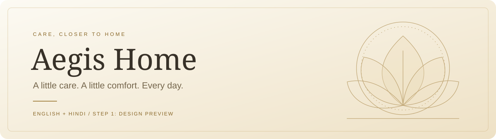

<div align="center">



**A calmer place for everyday care.**

Medicines, daily routines, familiar music, and a little company — in English and Hindi.

[Explore the preview](#try-it-yourself) · [What works today](#step-1--the-first-preview) · [Where we're going](docs/roadmap.md) · [The challenge](docs/challenge.md)

</div>

---

## Why Aegis Home

Remembering a medicine should not mean learning a complicated app. Asking for help should not mean handing over control of your day.

Aegis Home is being built for older people in India and the people who care about them. The idea is simple: bring the small things that matter into one comfortable place, with familiar language and fewer things to figure out.

The first design uses warm whites, muted gold, and a quiet lotus motif. English and Hindi sit one tap apart. The main screen starts with today: medicines, a few daily rituals, and the next doctor visit.

## Step 1 — the first preview

This is the first design checkpoint. You can click through the app and try the local interactions. The parts that need a server are clearly marked inside the preview.

| Ready to try | What it does |
| --- | --- |
| English / हिन्दी | Switches the interface language without leaving the page. |
| Medicines | Add, edit, or remove a schedule; mark a dose taken and undo it. |
| Daily routine | Add activities and tick them off. |
| Appointments | Save a visit with its date, time, and location. |
| Peace & music | Find bhajans or classical music on YouTube, play your own audio, or take a quiet minute. |
| Saathi | Try a sample conversation with the planned companion. Replies are scripted for now. |
| Care circle | See how family and caregiver invitations could work. Sharing is not active yet. |
| Reading comfort | Switch to larger text. The layout also adapts to smaller screens. |

**This is a preview, not a live care service.** It does not send emails, generate secure passcodes, connect family accounts, or use a live AI model. Information stays in this browser. Please use made-up details while trying it out.

## Try it yourself

**Quickest way:** open [previews/step-1.html](previews/step-1.html), choose **Download raw file** on GitHub, and open the downloaded file in Chrome or Edge. GitHub displays the source; downloading opens the actual app.

**To work on the source:** install Node.js, clone this repository, and run:

```sh
git clone https://github.com/XelixSensei/Aegis-Home.git
cd Aegis-Home
npm start
```

Then open **http://127.0.0.1:4173**. There are no packages to install for this step.

```sh
npm run check          # Check JavaScript syntax
npm run build:preview  # Refresh the single-file preview
```

The preview uses Google Fonts when a connection is available, with local font fallbacks. Music search links open YouTube in another tab; they may show ads. Songs chosen from your device are not uploaded.

## Around the repository

| Folder | What belongs here |
| --- | --- |
| [`public/`](public/) | The editable app: page, styles, and interactions. |
| [`scripts/`](scripts/) | A small local server and the preview builder. |
| [`previews/`](previews/) | The downloadable Step 1 preview. |
| [`docs/`](docs/) | The challenge, design decisions, next steps, and review notes. |

## Next: make the care features real

The next stage is secure sign-in and shared profiles, followed by proper dose records, email reminders, and a live Saathi connection. A working Google Cloud Run deployment is part of the hackathon requirements.

The [roadmap](docs/roadmap.md) separates what is built from what is still planned. The [review notes](docs/step-1.md) explain what was checked and what still needs a browser review.

---

<div align="center">

**A little care. A little comfort. Every day.**

थोड़ी देखभाल। थोड़ा सुकून। हर दिन।

</div>
