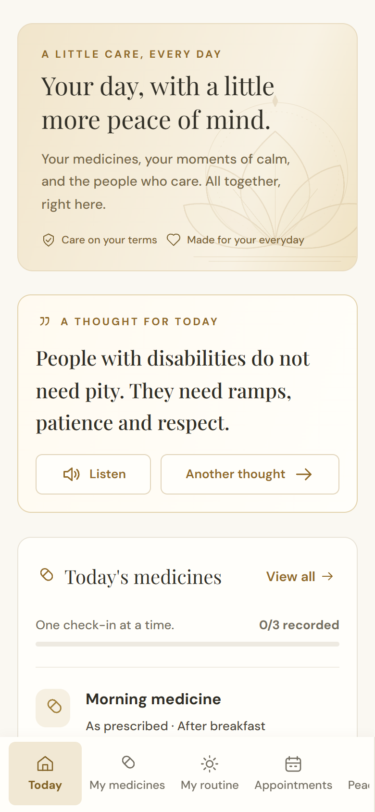
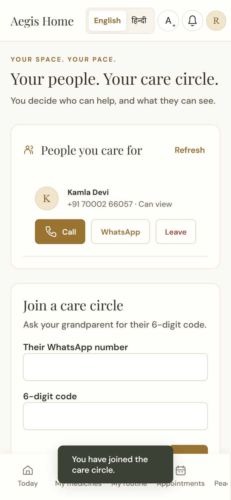
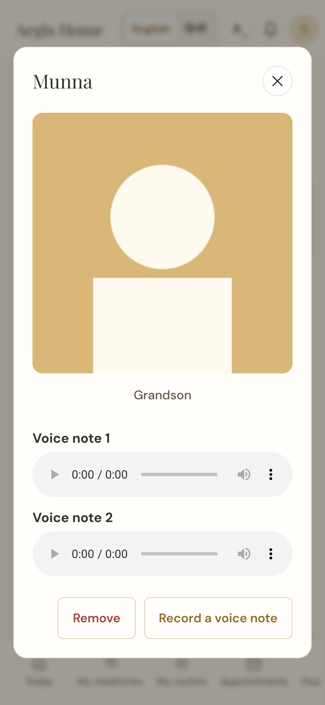
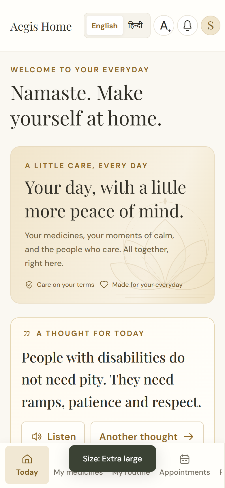
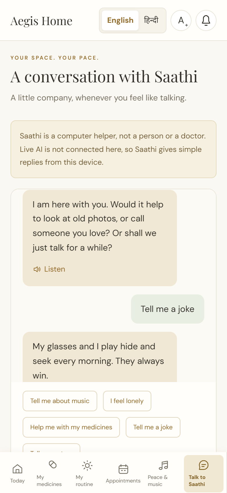
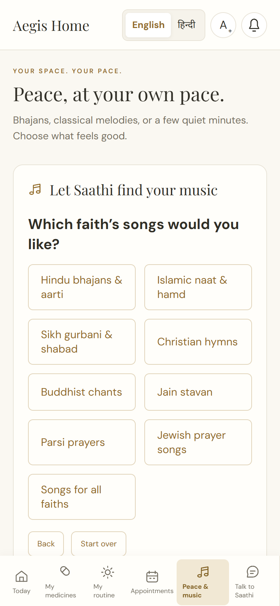
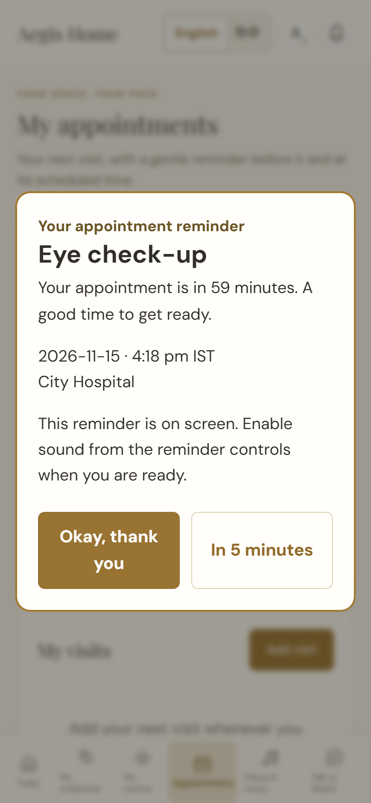
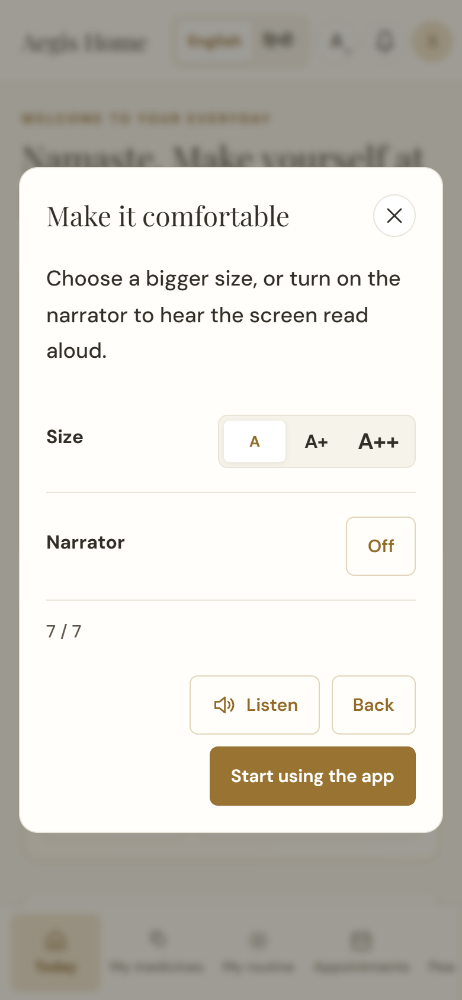

<div align="center">


**A calmer place for everyday care.**

Medicines, routines, familiar music, the voices of loved ones, and a little company, in English and Hindi, for older people in India and the families and care homes who look after them.

[Try the preview](previews/step-5.html) · [Latest notes](docs/step-5.md) · [Supabase setup](docs/supabase-setup.md) · [The challenge](docs/challenge.md)

</div>

---

## Why Aegis Home

Many older people in India live alone, take several medicines a day, and are not comfortable with small text or complicated apps. Their children often live in other cities. Some are left with no one at all.

Aegis Home brings everyday care into one gentle place:
- big, readable buttons and text in English or Hindi
- reminders that ring on time
- a companion to talk to
- a care circle that keeps family close
- verified elderly homes that can step in when someone is abandoned

## Who it's for

| | What they get |
|---|---|
| 👵 **Grandparents** | Medicines with photo check-ins, daily routine and appointment alarms, Saathi to talk to, music they love, photos and voices of family, and a thought for the day |
| 🧑‍🤝‍🧑 **Caretakers** (family or carers) | Join a grandparent's care circle with a 6-digit code, see their care, help manage it if allowed, and call or WhatsApp in one tap |
| 🏠 **Elderly homes** | A government-verified account; receive alerts from nearby older people who need a safe place *(alerts arrive in Step 6)* |

## Features

### Everyday care
- **Medicines:** schedules in India Standard Time, with a daily **photo check-in** taken while having the medicine. Status moves from upcoming to due to overdue.
- **Daily routine:** activities that repeat every day, each with its own **alarm**.
- **Appointments:** alarms **1 day, 1 hour or 15 minutes before**, and at the time.
- **Gentle alarms:** a soft chime, "Okay, thank you", or "In 5 minutes". Missed reminders from earlier today are shown when you return.

### Company and comfort
- **Saathi:** a warm AI companion (Claude) that chats about anything in English, Hindi or Hinglish. It remembers the conversation and knows today's schedule, and there is a Listen button and a microphone. Without a key, an offline Saathi still holds a real conversation. Saathi never advises medicine doses. Emergency words show **Call 112 / 108** buttons; feeling abandoned shows **Elderline 14567**.
- **Peace & music:** Saathi asks one easy question at a time: a favourite singer, then the type of music, then the faith or style (bhajans, naat, gurbani, hymns, classical ragas, old film songs, regional languages and more). The songs then **play inside the app**.
- **My loved ones:** name or nickname, a photo, a video and **voice notes** recorded in the app. Tap a face to hear their voice.
- **A thought for today:** 60 short thoughts in simple English and Hindi, sometimes with a little humour, on:
  - living together across religions and castes
  - beliefs and reality, without attacking anyone's faith
  - clean streets and rivers
  - avoiding scams
  - health, equality and kindness

  The thoughts never repeat until all 60 have been shown.

### Family and safety
- **Accounts:** Grandparent, Caretaker or Elderly Home. Sign in with a **WhatsApp number and a 6-digit passcode**; there are no SMS codes to wait for.
- **Care circle:** the grandparent shares a 6-digit code (one use, 24 hours, 5 tries) on WhatsApp. They choose **view only** or **help manage**, and can remove anyone at any time.
- **Verified elderly homes:** they upload their registration certificate and location. An admin checks it before the home can receive any alert.

### Made for older eyes and hands
- Heavier, larger text, high contrast, and buttons at least 48 px tall.
- **Three sizes** (A / A+ / A++); text, buttons and spacing grow together.
- A **touch narrator** for people with low vision: touch or slide a finger to hear the screen, and tap twice to press.
- A **one-minute tour** on first use, which can be read aloud.
- Works well on phones; every page is reachable from the bottom bar.
- Full **English and Hindi**, switchable at any time.

## Screens

| Today | Care circle | Loved ones | Extra large size |
|---|---|---|---|
|  |  |  |  |

| Saathi | Music guide | Appointment alarm | Tour |
|---|---|---|---|
|  |  |  |  |

## Coming next: Step 6
- **WhatsApp alerts:** emergency messages and **live location** sent to the care circle.
- **Medicines, shared:**
  - a dose counts as taken only with a photo
  - the care circle can see the photos
  - the care circle is alerted when medicines are missed
- **"I've been abandoned" button:** sends the person's location to the **nearest verified elderly homes**.
- **Caretaker emergency button:** calls for family help fast.
- **Emergency services section:** ambulance 108, police 112/100, fire 101, women's helpline 1091, Elderline 14567, cyber fraud 1930 and more.
- **Deployment:** Vercel, plus the Google Cloud Run deployment the challenge requires.

## How it's built

```
Browser (plain HTML, CSS, JavaScript; no build step)
  │  public/  ── each step adds its own files and builds on the last
  │
  ├── /api/saathi, /api/music  ──►  Claude (Anthropic API) · YouTube Data API
  ├── /api/config, /api/health ──►  public settings only, never secrets
  │
  └── Supabase (Postgres + Storage), straight from the browser, protected by Row Level Security
        profiles · care_links · elderly_homes · medicines · dose_checkins · alerts · loved_ones
```

- **Front end:** plain JavaScript, so it works on low-end phones. Pure logic lives in small, tested modules: alarms, the dose ledger, the music guide, offline Saathi, quotes and phone numbers.
- **Server:** small Node functions in `api/`, run as Vercel functions and reused by the local server.
- **AI:** Claude for Saathi and for picking music, with a safe offline fallback.
- **Data:** Supabase, with privacy enforced in the database itself (Row Level Security). Files go to private storage with short-lived links.

## Privacy and security
- **Row Level Security on every table.** A caretaker sees nothing until the grandparent shares a code, and an elderly home sees an elder only when that elder's alert was sent to it.
- Invite codes are stored **hashed**; they expire after 24 hours and lock after 5 wrong tries.
- People cannot claim someone else's phone number, change their own role, or approve their own elderly home.
- Photos, videos, voice notes and certificates sit in **private** storage buckets.
- Secret keys stay on the server, in `.env` or Vercel. The browser only ever receives the public Supabase key.
- APIs accept small JSON only, clean every input, and are rate-limited.
- Without an account, everything stays on the device.

## Run it yourself

```sh
git clone https://github.com/XelixSensei/Aegis-Home.git
cd Aegis-Home
npm install
cp .env.example .env
npm start            # http://127.0.0.1:4174
```

Every key in `.env` is optional, and the app tells you plainly what is off.

| Key | Turns on |
|---|---|
| `ANTHROPIC_API_KEY` | Live Saathi chat and smart music picks |
| `YOUTUBE_API_KEY` | Faster, exact song results |
| `SUPABASE_URL`, `SUPABASE_ANON_KEY` | Accounts, care circle, shared loved ones. See [Supabase setup](docs/supabase-setup.md) |

To try it without installing anything, download [`previews/step-5.html`](previews/step-5.html) (GitHub: **Download raw file**) and open it in Chrome or Edge. It runs offline on the device.

**Deploying on Vercel:** import the repository and add the same environment variables. `vercel.json` serves `public/` and pings Supabase daily so the free project never pauses.

## Tests

```sh
npm test         # 35 automated tests
npm run check    # syntax check of every JavaScript file
```

The tests cover:
- alarm timing at IST midnight, snooze and early appointment alarms
- medicine check-ins
- the music guide for every faith
- offline Saathi safety replies
- phone numbers and passcodes
- the quote deck
- **38 database privacy checks run against a real Postgres engine** (PGlite)

Each step was also checked in a real browser at desktop and phone sizes, and Step 5 was tested end to end against the live Supabase project.

## Project structure

| Folder | Contents |
|---|---|
| `public/` | The app: pages, styles and logic (`stepN.js` and `stepN.css` per step) |
| `api/`, `server/` | Saathi, music, config and keep-alive endpoints |
| `supabase/migrations/` | Database tables, privacy rules and functions |
| `tests/` | Automated tests |
| `scripts/` | Local server, checks and preview builder |
| `previews/` | Downloadable single-file preview of each step |
| `docs/` | Build notes per step, screenshots, setup guides, roadmap and challenge brief |

## Checkpoints

| Step | What it added | Notes |
|---|---|---|
| [Step 1](previews/step-1.html) | The white-and-gold English and Hindi design | [Notes](docs/step-1.md) |
| [Step 2](previews/step-2.html) | Daily medicine photo check-ins | [Notes](docs/step-2.md) |
| [Step 3](previews/step-3.html) | Routine and appointment alarms | [Notes](docs/step-3.md) |
| [Step 4](previews/step-4.html) | Saathi chat, guided music, early appointment alarms | [Notes](docs/step-4.md) |
| [Step 5](previews/step-5.html) | Accounts, care circle, loved ones, thought for the day, sizes, narrator, tour | [Notes](docs/step-5.md) |
| Step 6 | WhatsApp alerts, shared medicine photos, abandonment and emergency help | *In progress* |

Each step is built on its own branch and merged through a reviewed pull request.

## Honest limits
- Alarms need the app open and the phone awake; background alarms are not built yet.
- A medicine photo records a check-in. It cannot prove the medicine was swallowed.
- Saathi is an AI, not a person or a doctor, and it says so.
- Elderly homes are verified by a person checking their registration; there is no public government API for this.

---

<div align="center">

*A little care. A little comfort. Every day.*

Built for the PromptWars / Catalyst challenge.

</div>
