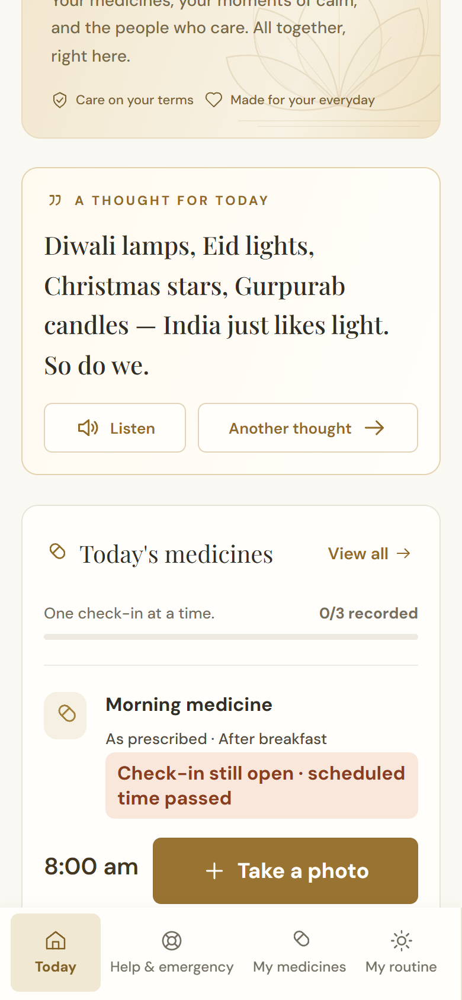
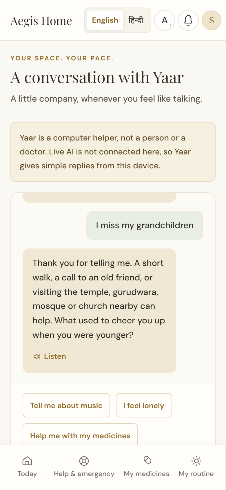
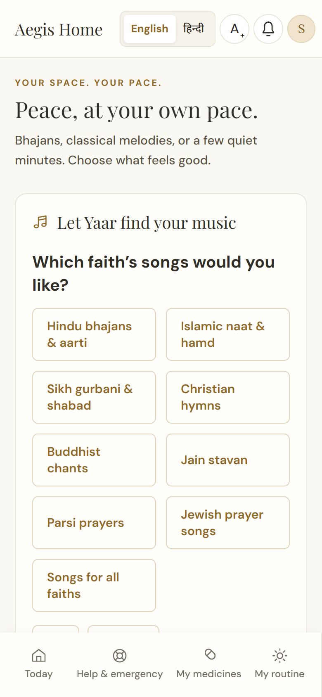
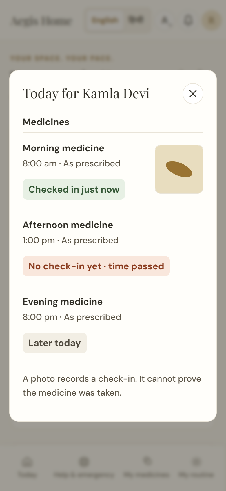
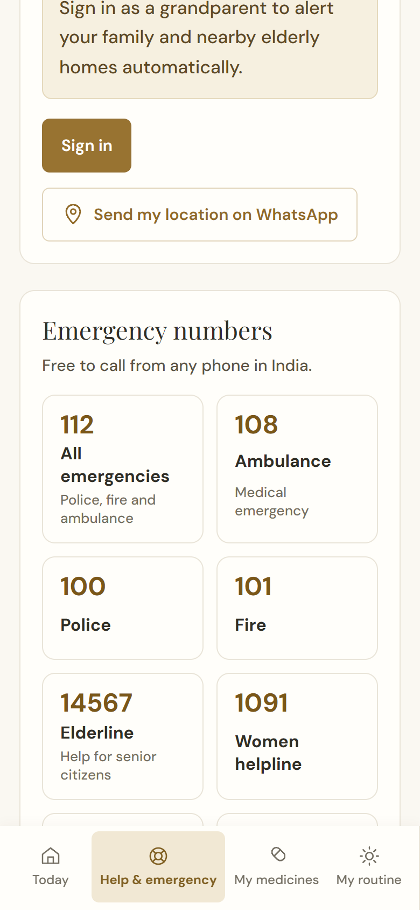
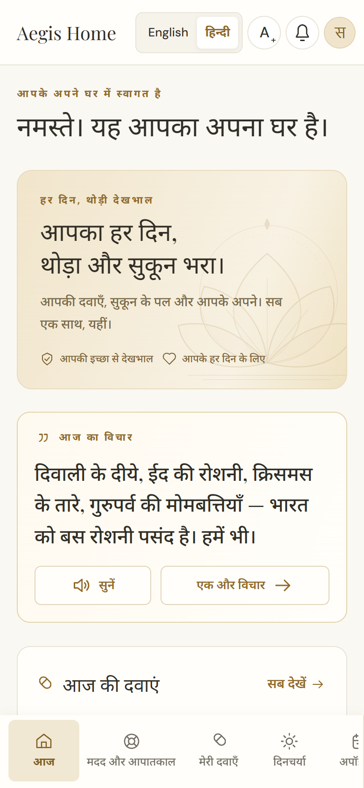

<div align="center">


**A calmer place for everyday care.**

A bilingual (English & Hindi) care app for older people in India, their families, and the elderly homes that can step in when no one else does.

[Try the preview](previews/step-6.html) · [Build notes](docs/step-6.md) · [Supabase setup](docs/supabase-setup.md) · [The challenge](docs/challenge.md)

</div>

---

## The problem

Millions of older people in India live alone or far from their children. Many take several medicines a day and find phones hard: small text, English-only screens, too many steps. When something goes wrong (a missed medicine, a fall, being left with no one), help often arrives too late, or not at all.

## What Aegis Home does

One gentle app that keeps everyday care simple and keeps the right people close.

| | |
|---|---|
| 💊 **Medicines that are checked, not guessed** | Each dose is checked in with a photo. Family can see it, and they are alerted if a medicine is missed. |
| ⏰ **Reminders that ring** | Daily routines and doctor visits, with alarms 1 day, 1 hour or 15 minutes before. |
| 🫂 **Trusted People** (अपने लोग) | Family and carers join with a 6-digit code chosen by the grandparent, who stays in control. |
| 🆘 **Help in two taps** | **Alert my family**, or **I have been abandoned**: the nearest *verified* elderly homes are told, with live location. |
| 💬 **Yaar** (यार), a companion | A warm AI companion who chats in Hindi, English or Hinglish, plays the music you love, and never gives medical doses. |
| 👨‍👩‍👧 **Loved ones, close by** | Photos, videos and voice notes from family, by name or nickname. |
| 👓 **Made for older eyes** | Big text in three sizes, a touch narrator, and a one-minute tour. |

## Three kinds of people, one app

| Who | What they get |
|---|---|
| 👵 **Grandparents** | Their medicines, routine, appointments, music, Yaar, loved ones, Trusted People, a thought for the day, and the Help & emergency page |
| 🧑‍🤝‍🧑 **Caretakers** (family or carers) | **Today's care** for each grandparent with check-in photos, live alerts with Call, WhatsApp and live location, and "I'm on it" |
| 🏠 **Elderly homes** | A government-verified account that receives alerts, with location, from nearby older people who need a safe place |

Everyone signs in with a **WhatsApp number and a 6-digit passcode**. There are no SMS codes to wait for.

## Screens

| Today | Yaar | Music, by faith |
|---|---|---|
|  |  |  |

| Help in two taps | The family's alert | Today's care |
|---|---|---|
|  |  |  |

| Emergency numbers | Loved ones | In Hindi |
|---|---|---|
|  |  |  |

## Features in detail

### Everyday care
- **Medicines:** schedules in India Standard Time. A dose is checked in only with a **photo taken while having it**. Status moves from upcoming to due to overdue.
- **Daily routine** with alarms. **Appointments** with alarms 1 day, 1 hour or 15 minutes before, and at the time.
- **Gentle alarms:** a soft chime, "Okay, thank you", or "In 5 minutes". Missed reminders from earlier today are shown on return.

### Trusted People and alerts
- **Trusted People:** the grandparent shares a 6-digit code on WhatsApp. It works once, for 24 hours, with 5 tries. They choose *view only* or *help manage*, and can remove anyone at any time.
- **Shared check-ins:** medicines and check-in photos are shared privately with Trusted People, who see **Today's care** at a glance.
- **Missed-medicine alerts:** every 10 minutes, the database checks for medicines more than 30 minutes late with no check-in. Each miss alerts Trusted People **once**.
- **Alert my family:** Trusted People see the alert **within seconds**, with a chime, Call and WhatsApp buttons, and **live location** that refreshes every 30 seconds until **I'm safe now**.
- **I have been abandoned:** the alert goes to **verified elderly homes whose service area covers the person**, nearest first. If none is near, the app offers Elderline 14567.
- **Verified elderly homes:** they upload their registration certificate and location, and an admin checks it before they can receive any alert.

### Help & emergency
- Tap-to-call cards:
  - **112** (all emergencies)
  - **108** (ambulance)
  - **100** (police)
  - **101** (fire)
  - **14567** (Elderline)
  - **1091** (women)
  - **1930** (cyber fraud)
  - **14416** (Tele-MANAS)
  - **104** (health helpline)
  - **1078** (disaster)
- **Find nearby:** hospitals, police station, medical store and old age homes.
- **Send my location on WhatsApp**, even without an account.

### Company and comfort
- **Yaar:** a warm companion (Claude) that remembers the conversation and knows today's schedule. It has Listen and microphone buttons. Without a key, an offline Yaar still holds a real conversation. Words like "chest pain" bring up **Call 112 / 108** buttons.
- **Peace & music:** Yaar asks one easy question at a time:
  1. a favourite singer
  2. the type of music
  3. the faith or style: bhajans, naat, gurbani, hymns, ragas, old film songs, regional languages and more

  Then the songs **play inside the app**.
- **My loved ones:** a name or nickname, a photo, a video and **voice notes** recorded in the app.
- **A thought for today:** 60 short thoughts in simple English and Hindi, sometimes with a little humour. Topics:
  - living together across religions and castes
  - beliefs and reality, without attacking anyone's faith
  - clean streets
  - avoiding scams
  - health, equality and kindness

  No thought repeats until all 60 have been shown.

### Accessibility
- Heavier, larger text, high contrast, and buttons at least 48 px tall.
- **Three sizes** (A / A+ / A++); everything grows together.
- A **touch narrator**: touch or slide a finger to hear the screen, and tap twice to press.
- A **one-minute tour** on first use, which can be read aloud.
- Full **English and Hindi**, switchable at any time.
- Every page is reachable on a phone.

## How it's built

```
Browser — plain HTML, CSS and JavaScript (no build step; fast on low-end phones)
  │
  ├── /api/saathi · /api/music  ──►  Claude (Anthropic API) · YouTube Data API
  ├── /api/config · /api/health ──►  public settings only, never secrets
  │
  └── Supabase
        Postgres with Row Level Security · private Storage · Realtime alerts · Cron (missed medicines)
```

| Layer | Choice |
|---|---|
| App | Plain JavaScript; each step adds its own files and builds on the last |
| AI | Claude, for Yaar and for picking music, with a safe offline fallback |
| Data | Supabase: Postgres, Storage, Realtime, Cron |
| Server | Node functions in `api/`, deployed as Vercel functions and reused by the local server |
| Hosting | Vercel (`vercel.json` serves `public/` and keeps Supabase awake) |

## Privacy and security
- **Row Level Security on every table.** A caretaker sees nothing until the grandparent shares a code. An elderly home sees someone only when that person's alert was sent to it.
- Invite codes are stored **hashed**; they expire after 24 hours and lock after 5 wrong tries.
- Nobody can claim someone else's phone number, change their role, or approve their own elderly home.
- Only the grandparent can move their own live location. Location sharing stops at "I'm safe now".
- Photos, videos, voice notes and certificates are kept in **private** storage with short-lived links.
- Secret keys stay on the server. The browser only receives the public Supabase key.
- APIs accept small JSON only, clean every input, and are rate-limited.
- Without an account, everything stays on the device.

## Run it yourself

```sh
git clone https://github.com/XelixSensei/Aegis-Home.git
cd Aegis-Home
npm install
cp .env.example .env
npm start            # http://127.0.0.1:4174
```

| Key in `.env` (all optional) | Turns on |
|---|---|
| `ANTHROPIC_API_KEY` | Live Yaar chat and smart music picks |
| `YOUTUBE_API_KEY` | Faster, exact song results |
| `SUPABASE_URL`, `SUPABASE_ANON_KEY` | Accounts, Trusted People, shared check-ins, alerts |

**Supabase:** create a project, turn off "Confirm email", then run [`0001_core.sql`](supabase/migrations/0001_core.sql) and [`0002_alerts.sql`](supabase/migrations/0002_alerts.sql) in the SQL Editor. The full guide is in [docs/supabase-setup.md](docs/supabase-setup.md).

**Vercel:** import the repository, add the same environment variables, and turn off Vercel Authentication (Deployment Protection) so visitors can open the app.

**No install:** download [`previews/step-6.html`](previews/step-6.html) (GitHub: **Download raw file**) and open it in Chrome or Edge. It runs on the device.

## Tests

```sh
npm test         # 36 automated tests
npm run check    # syntax check of every JavaScript file
```

- **Logic:**
  - alarms at IST midnight, snooze and early appointment alarms
  - medicine check-ins
  - the music guide for every faith
  - Yaar's safety replies
  - phone numbers and passcodes
  - the thought deck
- **Database:** the real migrations run on a real Postgres engine (PGlite). They check who can see what, invite codes, elderly-home verification, alerts, live location, and missed medicines alerted exactly once.
- **Live:** Steps 5 and 6 were tested end to end on the real Supabase project, with a grandparent and a caretaker in two separate browsers. The automatic missed-medicine check fired on schedule.
- **Screens:** every step was checked at desktop and phone sizes, in English and Hindi.

## Project structure

| Folder | Contents |
|---|---|
| `public/` | The app: pages, styles and logic (`stepN.js` and `stepN.css` per step) |
| `api/`, `server/` | Yaar, music, config and keep-alive endpoints |
| `supabase/migrations/` | Tables, privacy rules, alert functions and the missed-medicine check |
| `tests/` | Automated tests, including database tests on PGlite |
| `scripts/` | Local server, checks and preview builder |
| `previews/` | A single-file preview of each step |
| `docs/` | Step notes, screenshots, setup guide, roadmap and challenge brief |

## How it was built: six reviewed steps

| Step | What it added | Notes |
|---|---|---|
| [1](previews/step-1.html) | The white-and-gold English and Hindi design | [Notes](docs/step-1.md) |
| [2](previews/step-2.html) | Daily medicine photo check-ins | [Notes](docs/step-2.md) |
| [3](previews/step-3.html) | Routine and appointment alarms | [Notes](docs/step-3.md) |
| [4](previews/step-4.html) | Yaar chat, guided music, early appointment alarms | [Notes](docs/step-4.md) |
| [5](previews/step-5.html) | Accounts, Trusted People, loved ones, thought for the day, sizes, narrator, tour | [Notes](docs/step-5.md) |
| [6](previews/step-6.html) | Shared check-ins, missed-medicine alerts, Alert my family, I have been abandoned, live location, emergency numbers | [Notes](docs/step-6.md) |

Each step was built on its own branch, reviewed, and merged through a pull request.

## Honest limits
- **Alarms and live location** work while the app is open; phones pause web pages in the background.
- **A medicine photo** records a check-in; it cannot prove the medicine was swallowed.
- **WhatsApp messages** open on the person's own phone, already written, for them to send. Sending them automatically would need Meta's WhatsApp Business API.
- **Elderly homes** are verified by a person checking their registration; there is no public government API for this.
- **Yaar** is an AI, not a person or a doctor, and says so.

## What's next
- A Google Cloud Run deployment, which the challenge requires, alongside Vercel.
- Caretakers editing medicines from their own phone.
- Background reminders, using a service worker and push notifications.

---

<div align="center">

*A little care. A little comfort. Every day.*

Built for the PromptWars / Catalyst challenge.

</div>
