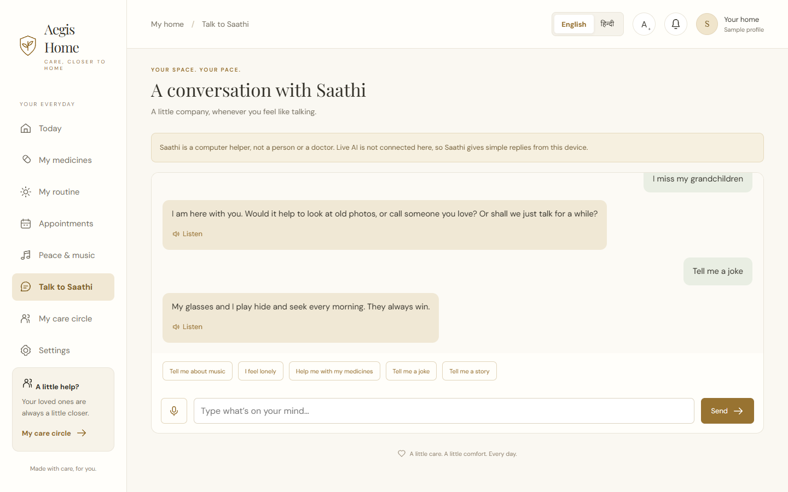
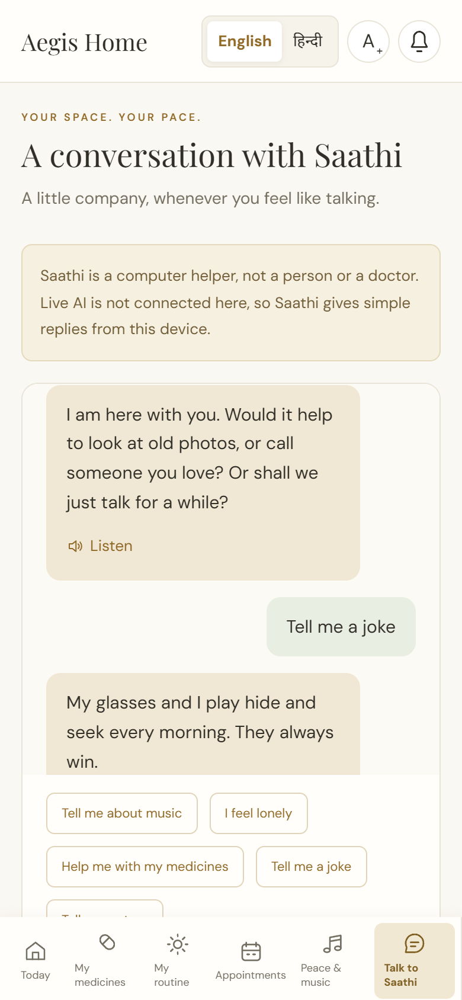
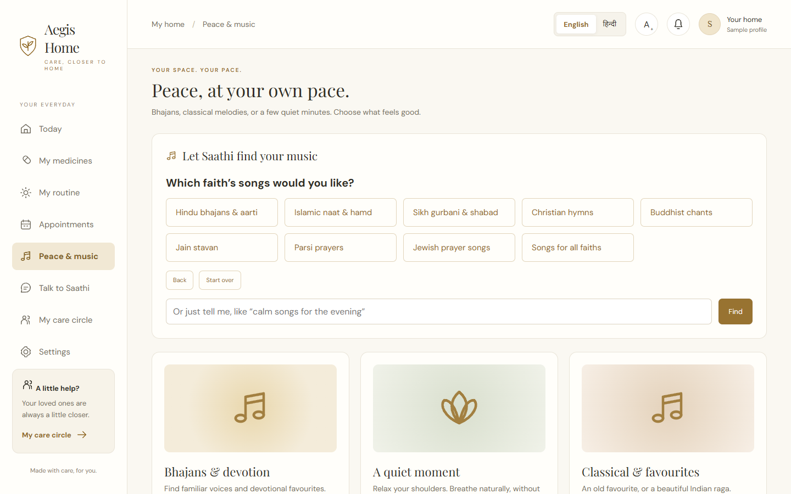
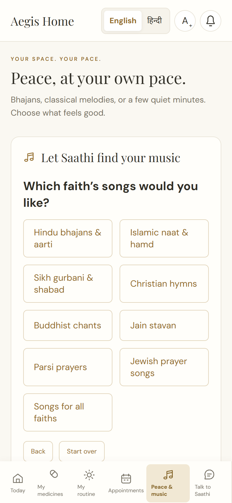
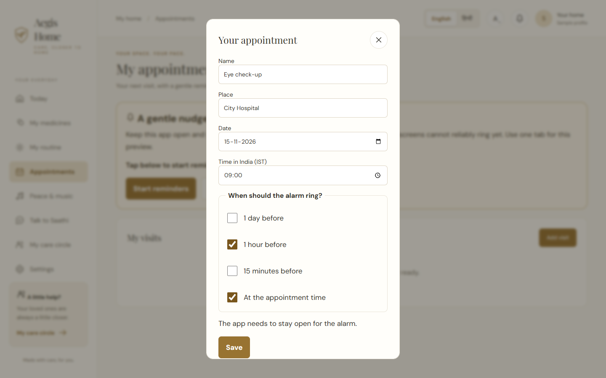
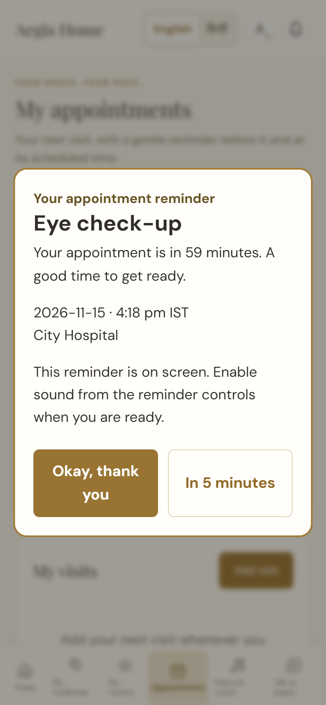

# Step 4: Yaar talks, music plays, visits ring early

This step builds on Step 3's alarms. The look of the app is unchanged; only these three features were improved.

## What's new

### 1. Yaar, a real conversation
- **Live AI** (when an Anthropic key is set): Yaar chats about anything — memories, family, food, festivals, prayer, cricket — in English, Hindi, or Hinglish, matching how the person writes. It remembers the conversation, uses simple words, and knows today's medicine, routine and appointment times.
- **Offline Yaar** (no key, or the downloadable preview): a much richer on-device conversation with greetings, feelings, family, memories, jokes, stories and more, in both languages. It remembers the person's name and avoids repeating itself.
- **Safety first, in both modes:** chest pain, falls, breathing trouble → "Call 112 / 108" buttons. Thoughts of self-harm → 112 and Tele-MANAS 14416. Feeling abandoned → Elderline 14567. Yaar never decides medicine doses.
- **Listen** button on every Yaar reply (reads it aloud), and a **microphone** button to speak instead of typing, where the browser supports it.
- The notice above the chat says plainly whether live AI is on, and that Yaar is not a person or a doctor.

### 2. Peace & music, guided by Yaar
- A new card at the top of Peace & music asks one easy question at a time:
  1. **Is there a singer you love?** Type a name to play their songs straight away, or skip.
  2. **What kind of music?** Religious, old film songs, classical, ghazal, sufi, folk, songs in my language, patriotic, instrumental, nature sounds, old English songs.
  3. **Religious →** which faith: Hindu, Islamic, Sikh, Christian, Buddhist, Jain, Parsi, Jewish, or songs for all faiths. Hindu → which bhajan (Krishna, Ram, Shiv, Hanuman Chalisa, Ganesh, Mata Rani, Sai Baba, aarti). Islamic → naat, hamd, Quran recitation, qawwali.
  4. Classical, instrumental, era and language questions where they apply.
- Or just **tell Yaar** what you'd like ("calm songs for the evening"); with live AI, Yaar turns it into a good search.
- Songs play **inside the app** in a small YouTube player that stays open while you move between pages, with Previous / Next song.
- Search uses the YouTube Data API when `YOUTUBE_API_KEY` is set, otherwise Claude's web search when only `ANTHROPIC_API_KEY` is set. With neither, the app offers an "Open on YouTube" link instead.
- The existing bhajan, quiet minute, classical and own-file cards are unchanged.

### 3. Appointment alarms, earlier and on time
- Each appointment can ring **1 day before, 1 hour before, 15 minutes before, and/or at the time**. New visits default to 1 hour before + at the time.
- An early alarm says "Your appointment is in 59 minutes. A good time to get ready."
- Early alarms stop once the visit time has arrived; acknowledgements and snoozes from Step 3 still work. Daily routine alarms are unchanged.

## Try it

```sh
npm install
cp .env.example .env     # optional: add ANTHROPIC_API_KEY and/or YOUTUBE_API_KEY
npm start                # http://127.0.0.1:4174
```

Or download `previews/step-4.html` (offline Yaar; music opens on YouTube).

## Screens

| | Desktop | Phone |
|---|---|---|
| Yaar |  |  |
| Music guide |  |  |
| Appointment alarms |  |  |

## How it's built

- `api/saathi.js`, `api/music.js`, `api/health.js`: Vercel functions. `scripts/serve.cjs` runs the same handlers locally.
- `server/claude.cjs`: model `claude-opus-5-5`, with Anthropic's server-side refusal fallback turned on. `server/saathi.cjs` holds Yaar's instructions; `server/music.cjs` handles search.
- Endpoints accept POST only, cap body size, clean input, rate-limit per address, and never expose keys. Keys live in `.env` (git-ignored).
- `public/saathi-local.js` and `public/music-guide.js` are pure logic with tests; `public/step4.js` and `public/step4.css` add the UI on top of the earlier steps.

## Checks

- 25 automated tests pass: appointment early alarms, the music guide, offline Yaar safety replies, server input cleaning, and graceful behaviour without keys.
- `npm run check` now syntax-checks every JavaScript file automatically.
- Checked in headless Chrome at desktop (1440×900) and phone (390×844) sizes.
- Live AI and in-app playback were **not** tested here because no API keys were available. They need a key to try.

## Still honest about limits

- Alarms still need the app open and the device awake.
- The embedded player depends on YouTube; some videos refuse embedding, so use "Next song" or "Open on YouTube".
- Yaar is an AI or a scripted helper, never a doctor or a person.
