# Step 5: accounts, Trusted People, loved ones, and comfort for older eyes

This step builds on Step 4. The white-and-gold design is unchanged; text is a little heavier and larger, and each feature below was added in the same style.

## What's new

### 1. Accounts for three kinds of people (Supabase)
- **Grandparent**, **Caretaker** or **Elderly home**. Sign in with a **WhatsApp number and a 6-digit passcode**. No SMS or OTP is sent, so there is nothing to pay for.
- Easy passcodes (111111, 123456) are refused. Each number can have only one account.
- **Elderly homes** give their government registration number, a photo or PDF of the certificate, and their location. They stay "Waiting for verification" until an admin checks the registration and approves them. Only approved homes can receive alerts.
- Without Supabase (for example the downloadable preview), the app works as before on the device.
- Setup guide: [supabase-setup.md](supabase-setup.md).

### 2. A real Trusted People
- A grandparent creates a **6-digit invite code**, either "view my care" or "help manage". It works once, for 24 hours, with 5 tries, and can be shared on WhatsApp in one tap.
- A caretaker enters the grandparent's number and code to join, then sees them with **Call** and **WhatsApp** buttons.
- The grandparent sees everyone who joined, can switch them between view-only and help-manage, and can remove them at any time. Caretakers can leave.

### 3. My loved ones
- Add someone by **name or nickname**, with a **photo**, a **video** and **voice notes**. Voice notes can be recorded in the app or chosen as audio files.
- Tap a person to see their photo, play their voice notes and watch their video.
- A signed-in grandparent's loved ones are stored privately online and shared with their Trusted People. Otherwise they stay on the device.

### 4. A thought for today
- A small card on the Today page, in English or Hindi to match the app language. It uses simple words, sometimes with a little humour.
- **60 thoughts** on living together across religions and castes, beliefs and reality (without attacking anyone's faith), keeping streets and rivers clean, staying safe from scams, health, equality and kindness.
- A new thought every time the app opens, and with "Another thought". **All 60 are shown before any repeats.** A Listen button reads it aloud.

### 5. Easier to read and to tap
- Slightly heavier text, larger labels and higher contrast throughout. Buttons are at least 48 px tall.
- **Three sizes:** Standard, Large and Extra large. Text, buttons and spacing all grow together. Choose them in Settings, or tap the A+ button to step through them.
- **Phones:** every page, including Trusted People, Loved ones and Settings, is reachable from the bottom bar, which scrolls sideways. The account avatar stays in the top bar.

### 6. Narrator for people who can't see the screen well
- Settings → **Narrator**. When it is on:
  - touching something, or sliding a finger across the screen, reads aloud what is under the finger
  - on touch screens, the first tap on a button reads it and a second tap uses it
  - with a mouse, pointing at something reads it
- Hindi text is read with a Hindi voice, English with an Indian English voice.

### 7. A one-minute tour
- Shown the first time the app opens, with seven short steps.
- Every step has **Listen**, and the last step lets people choose a size and turn on the narrator straight away.
- It can be opened again from Settings → App tour.

## Checks
- **35 automated tests** pass. They include:
  - 38 database privacy checks run on a real Postgres engine
  - the quote deck: covers every topic, and never repeats until all have been shown
  - phone numbers and passcodes
  - the server only ever sends the public Supabase settings to the browser
- **Live on the real Supabase project**, two runs:
  - a direct check of 16 sign-up, sign-in and privacy cases
  - a full run through the app itself: grandparent creates code → caretaker joins → each sees the other → loved one with photo and voice note saved online → clean-up
- Screens checked at desktop (1440×900) and phone (390×844) sizes, with no browser errors. Screenshots are in `docs/screens/step-5-*`.

## Screens

| | Desktop | Phone |
|---|---|---|
| Today with a thought | 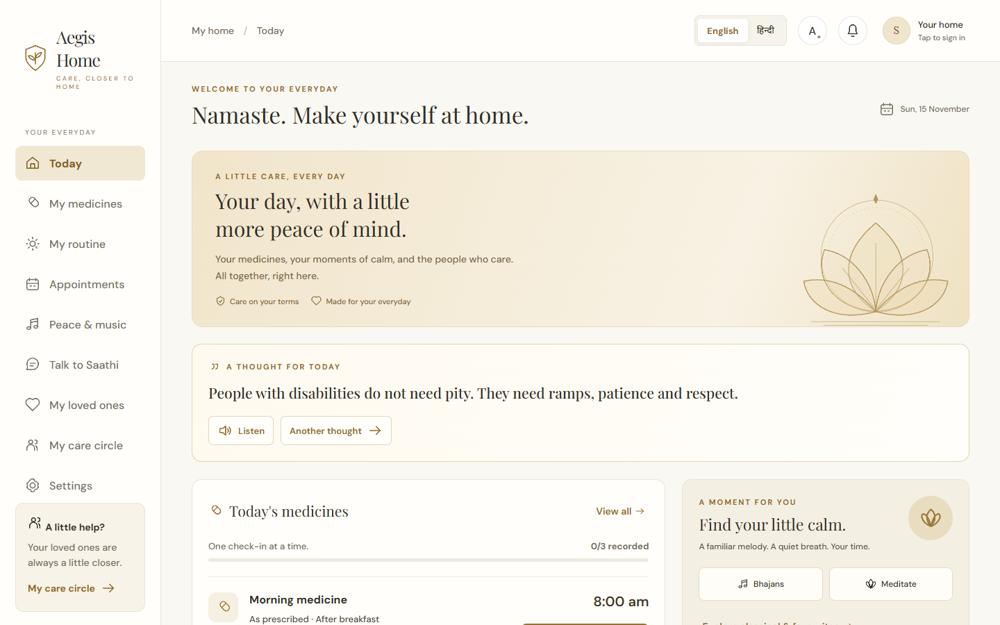 | 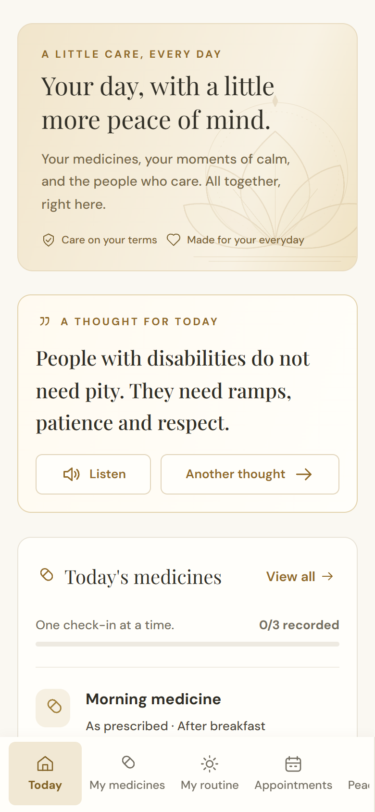 |
| Extra large size | | 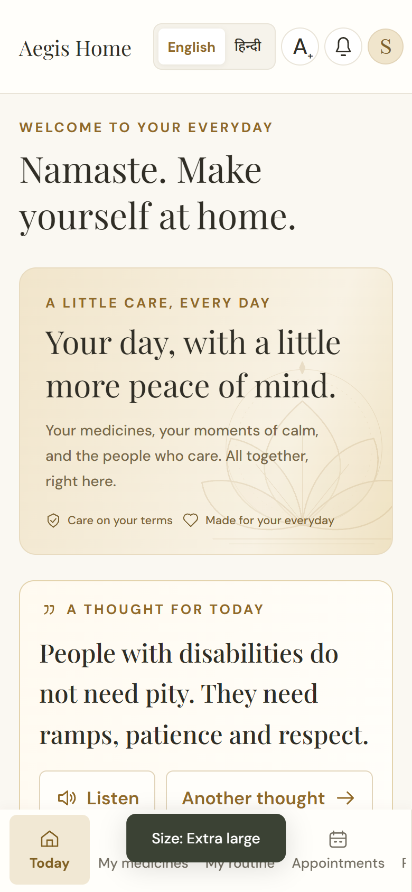 |
| Tour | 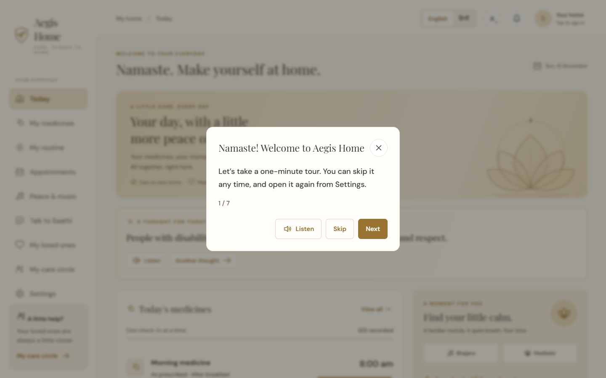 | 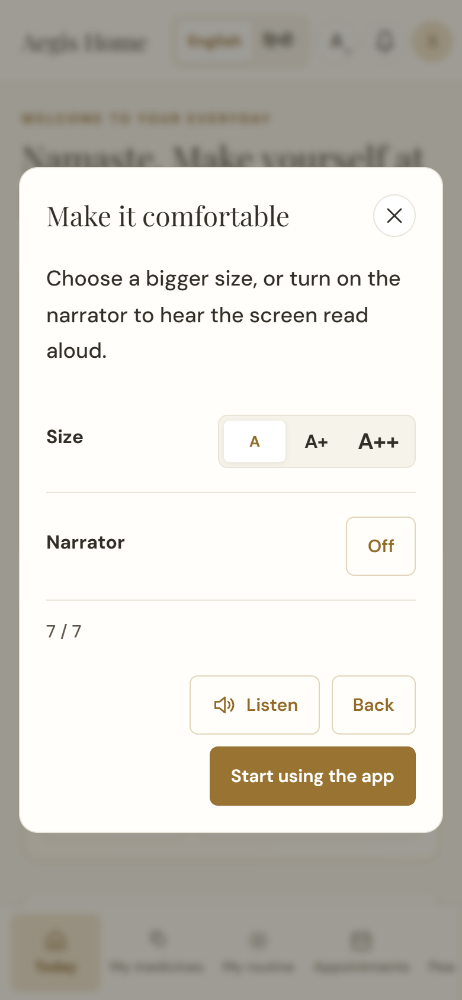 |
| Settings | 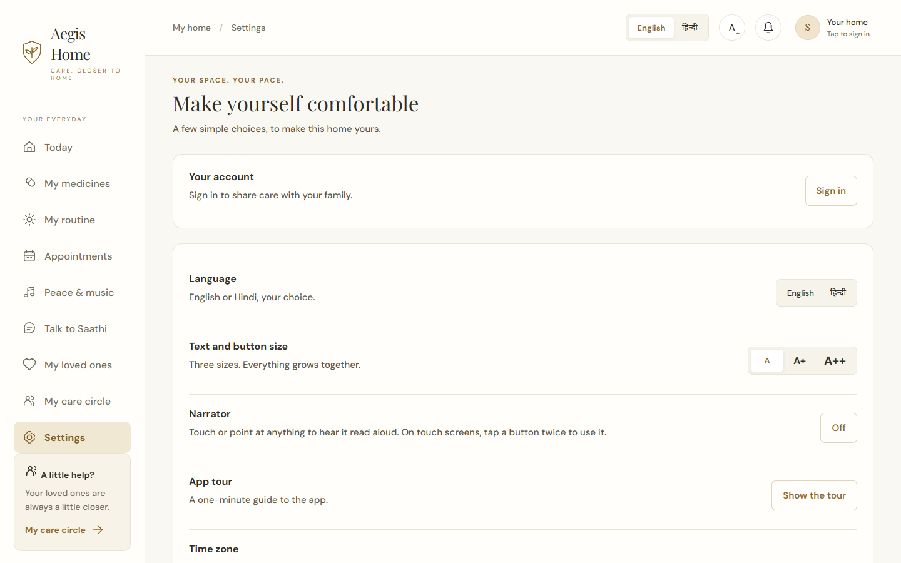 | 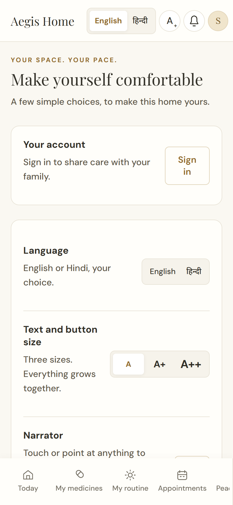 |
| Trusted People (grandparent) | 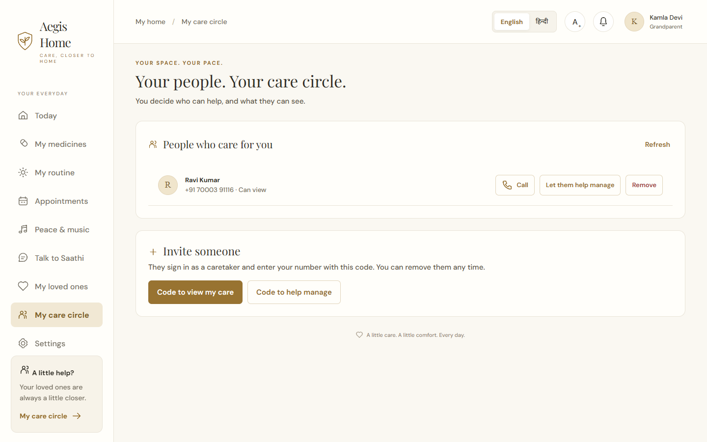 | 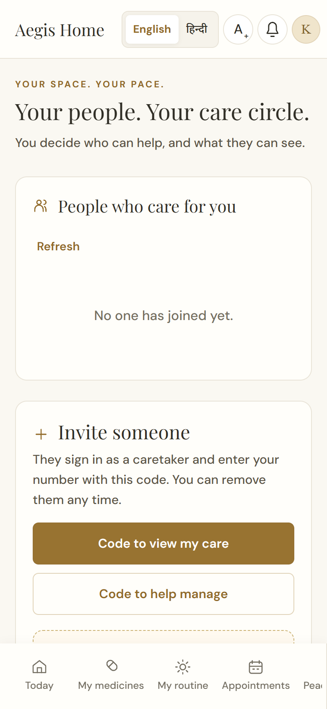 |
| Trusted People (caretaker) | 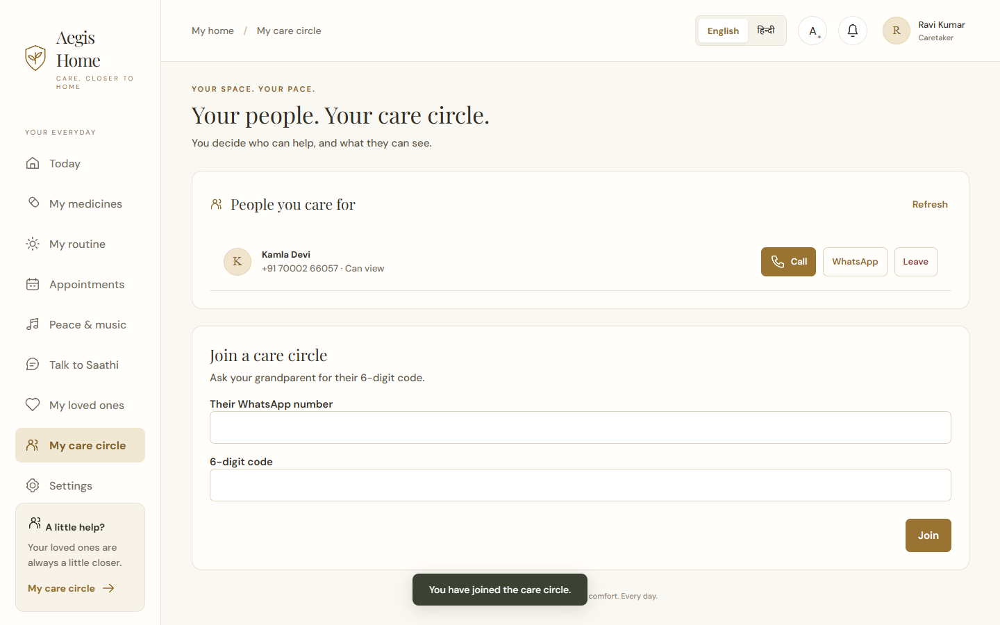 | 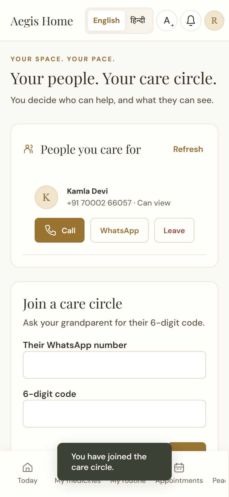 |
| Loved ones | 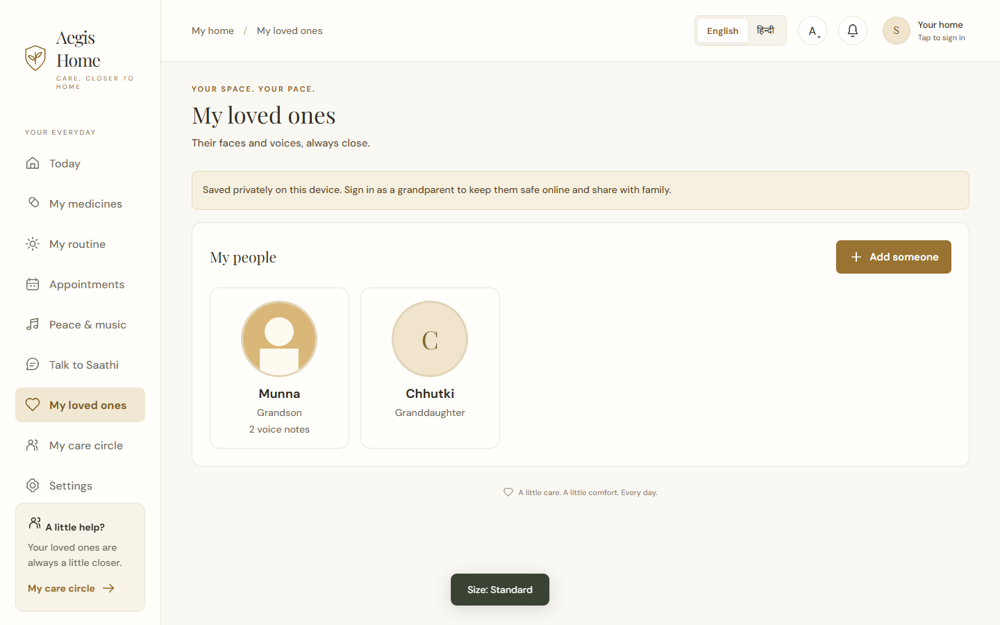 | 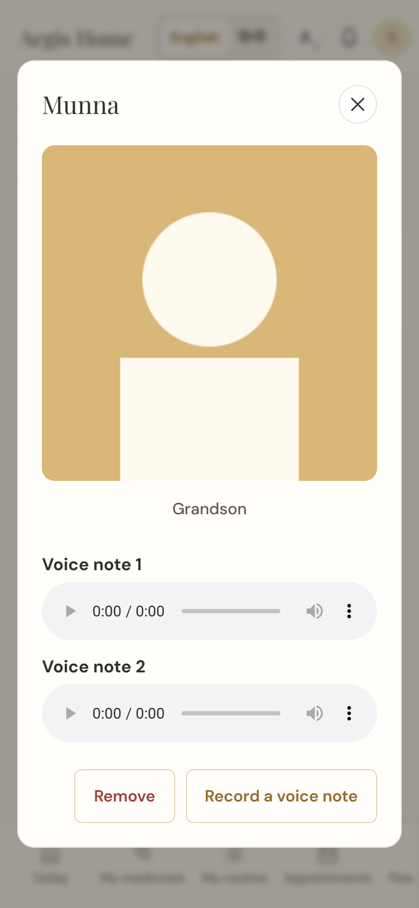 |

## Honest limits
- The narrator uses the phone's built-in voices; their quality depends on the device. Phones with TalkBack or VoiceOver can use those instead.
- Caretakers can't yet add loved ones for a grandparent from their own phone. The grandparent adds them.
- Alerts to caretakers and elderly homes, WhatsApp messages, medicine photo sharing and the emergency section come in Step 6.
