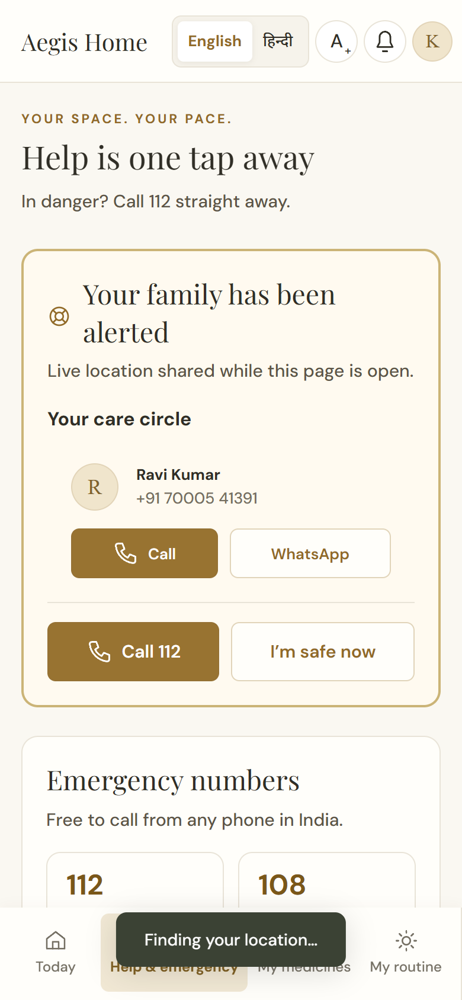
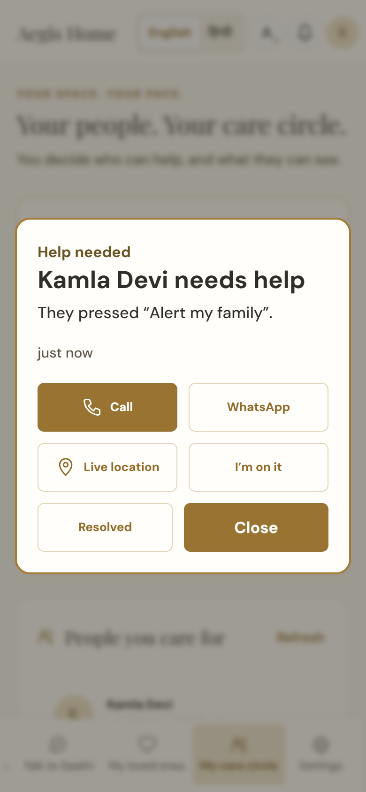
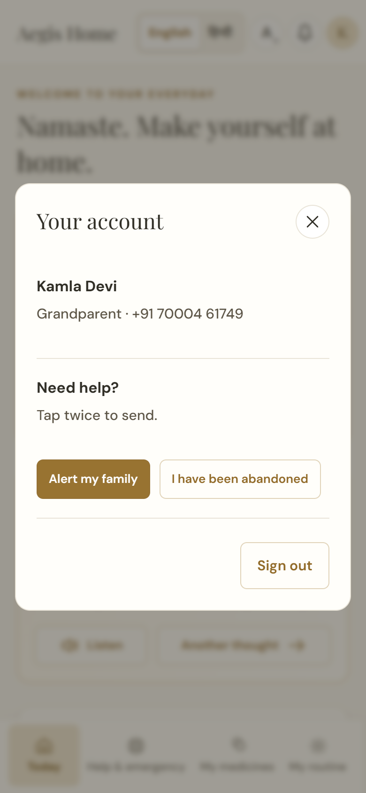
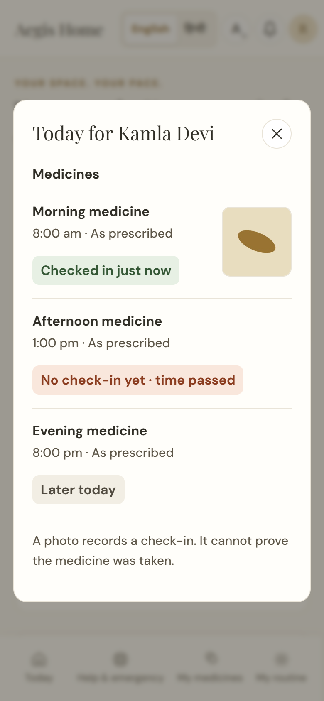
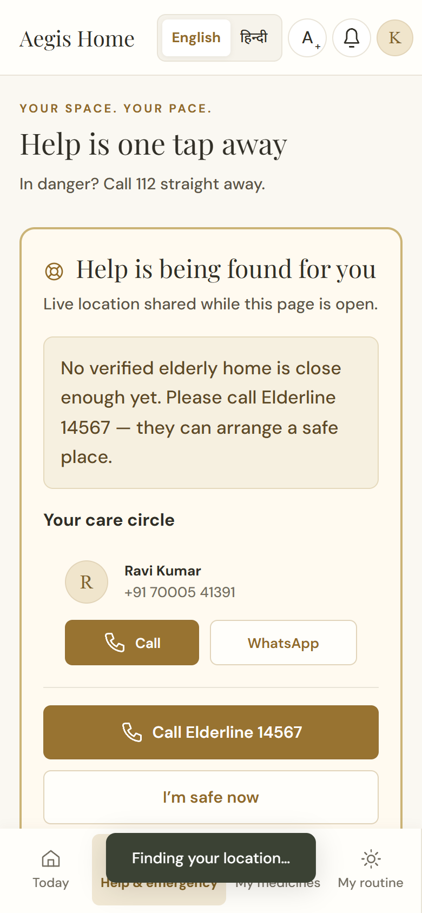
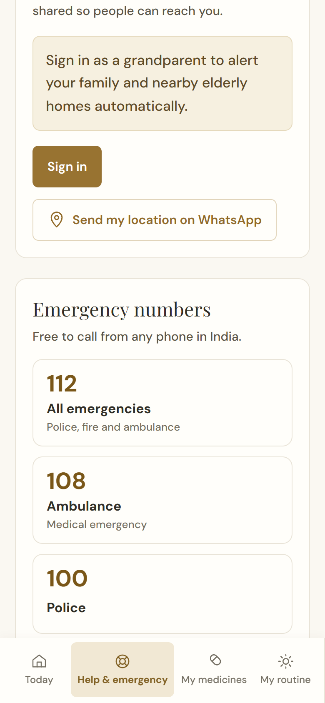
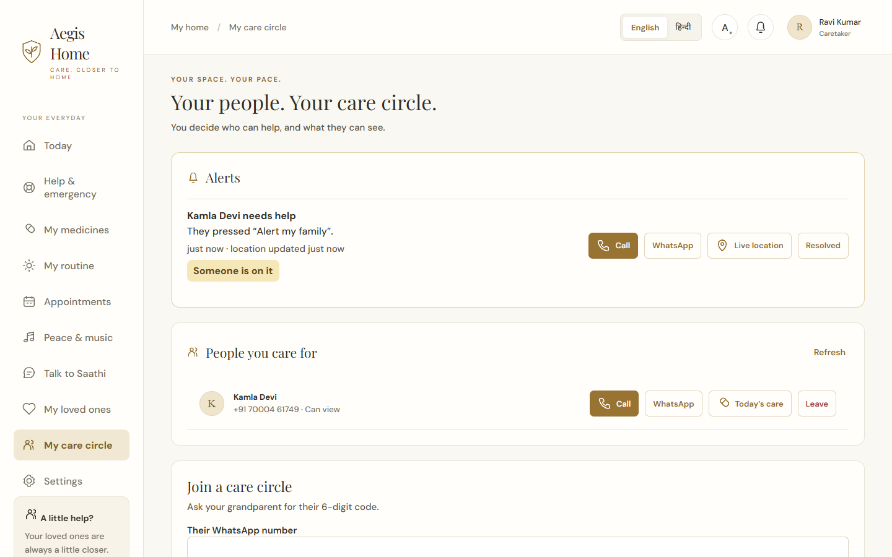

# Step 6: help that reaches people

This step builds on Step 5. The white-and-gold design is unchanged; each feature below was added in the same style.

## What's new

### 1. Today's medicines, shared with the care circle
- A dose is checked in only with a photo, as in Step 2. Now, for a signed-in grandparent, **the medicine list and each check-in photo are shared privately** with their care circle.
- A caretaker taps **Today's care** next to a grandparent's name and sees each medicine:
  - checked in, with its photo
  - due now
  - no check-in yet, time passed
  - later today
- If a check-in is removed on the grandparent's phone, it is removed for the care circle too.
- A saved check-in can also be **sent on WhatsApp**. On phones the photo itself is shared; elsewhere a short message is.

### 2. Missed-medicine alerts
- Every 10 minutes the database checks for medicines whose time passed more than 30 minutes ago (India time) with no photo check-in.
- Each missed medicine becomes **one** alert for the care circle, never repeated. It names the medicine, for example "No check-in yet for BP tablet (08:00)".
- Medicines added after their time that day are not counted as missed.

### 3. "Alert my family" and "I have been abandoned"
- Both buttons are on the new **Help & emergency** page and in the **profile** (Your account). Tap once, then tap again to send, so a slip of the hand sends nothing.
- **Alert my family:**
  - the care circle's app shows the alert **by itself**, within seconds, with a chime and a phone notification if allowed
  - the alert includes the grandparent's location
  - the grandparent sees their care circle with **Call** and **WhatsApp** buttons, the WhatsApp message already written with a map link
- **I have been abandoned:**
  - the alert goes to **verified elderly homes whose service area covers the person's location**, nearest first
  - the grandparent sees those homes with a Call button
  - if no verified home is near, the app says so and offers **Elderline 14567**
- **Live location:** while help is open and the app is open, the location is refreshed every 30 seconds for everyone who received the alert.
- **I'm safe now** ends the alert and stops sharing the location.

### 4. Caretakers and elderly homes receive alerts
- Caretakers get an **Alerts** section at the top of their care circle page. Each alert has Call, WhatsApp, Live location, **I'm on it** and **Resolved**.
- When a caretaker taps "I'm on it", the grandparent's alert shows that someone is on it.
- Elderly homes see **Alerts sent to your home**, with the same actions.
- Alerts arrive live (Supabase Realtime), with a once-a-minute check as a safety net. Optional browser notifications cover the times the page is in the background.

### 5. Emergency services
- One page with tap-to-call cards:
  - **112** (all emergencies)
  - **108** (ambulance)
  - **100** (police)
  - **101** (fire)
  - **14567** (Elderline)
  - **1091** (women)
  - **1930** (cyber fraud)
  - **14416** (Tele-MANAS)
  - **104** (health helpline)
  - **1078** (disaster)
- **Find nearby:** hospitals, police station, medical store and old age homes, on Google Maps.
- **Send my location on WhatsApp** works for everyone, even without an account.

## About WhatsApp
WhatsApp messages open on the person's own phone, already written, with a map link, for them to send. The app does not send WhatsApp messages by itself; that needs Meta's WhatsApp Business API and a verified business, which could be added later. Alerts inside Aegis Home *are* automatic.

## Setup
Run [`supabase/migrations/0002_alerts.sql`](../supabase/migrations/0002_alerts.sql) once in the Supabase SQL Editor, after `0001_core.sql`. It is safe to run again. It adds:
- live location and "I'm safe now"
- the missed-medicine check, scheduled every 10 minutes with Supabase Cron
- live alert updates

## Checks
- **36 automated tests** pass. Two of them run the database scripts on a real Postgres engine (PGlite):
  - who can see each alert
  - only the elder can move their location
  - "I'm safe now" stops updates
  - a missed medicine is alerted exactly once
  - people cannot trigger the check themselves
- **Live, on the real Supabase project**, with a grandparent and a caretaker in two separate browsers, 9 of 9 checks passed:
  1. the grandparent's 3 medicines were shared
  2. their check-in photo was shared
  3. the caretaker saw today's medicines with the photo
  4. "Alert my family" popped up on the caretaker's screen by itself
  5. the alert carried a live location link
  6. "I'm on it" reached the grandparent
  7. a location update reached the caretaker
  8. "I'm safe now" closed the alert
  9. "I have been abandoned" with no home nearby pointed to Elderline 14567
- Screens checked on desktop and phone, in English and Hindi, with no browser errors.

## Screens

| Grandparent | Caretaker |
|---|---|
|  |  |
|  |  |
|  |  |

## Honest limits
- Live location is shared while the app is open; phones pause web pages in the background.
- A caretaker sees medicines but cannot edit them from their phone yet.
- A photo records a check-in; it cannot prove the medicine was swallowed.
- Approving elderly homes is a manual check by an admin, because there is no public government licence API.
